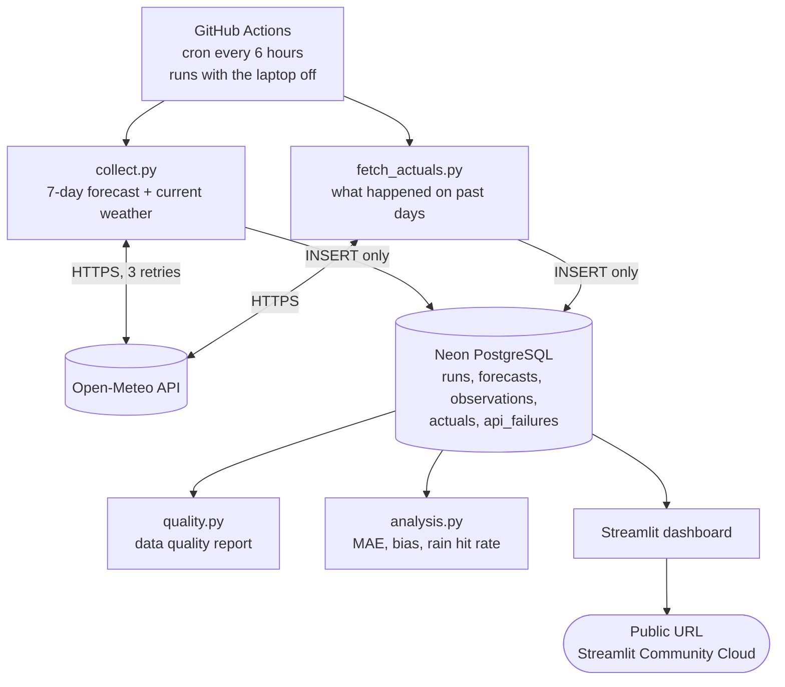
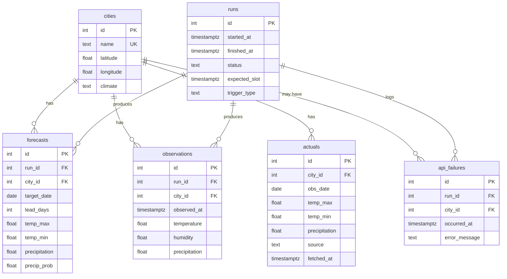

# weather-forecast-accuracy
# How accurate are weather forecasts?

A small data pipeline that collects 7-day weather forecasts for five cities every 6 hours, stores every
forecast without overwriting anything, compares them with what actually happened, and shows the results
on a public dashboard.

**Question:** how accurate are weather forecasts, and does accuracy drop the further ahead they predict?

- Live dashboard: **TODO paste the Streamlit URL here**
- Cities: Colombo (tropical), Dubai (desert), Reykjavik (cold oceanic), Singapore (equatorial), Moscow (continental)
- Data source: [Open-Meteo](https://open-meteo.com) (free, no API key)

## Architecture



(PNG copy: `docs/architecture.png`)

## Database design



(PNG copy: `docs/db_diagram.png`)

**Why it is designed this way**

- `runs` has one row per collector run, with its own timestamp. Every `forecasts` row points to its run, so the
  same target date forecast on different days is stored as separate rows. Nothing is updated or overwritten:
  that is what makes it possible to measure accuracy by lead time.
- `forecasts.lead_days` = target date minus the run's local date (1 = tomorrow ... 7 = a week ahead).
- `UNIQUE (run_id, city_id, target_date)` stops duplicates if a run is retried.
- `actuals` is a separate table because "what happened" arrives later than the forecast and has a different source.
  `UNIQUE (city_id, obs_date)` means one actual per city and day.
- `api_failures` records every failed call with its reason; `runs.status` is `success`, `partial` or `failed`.
- `runs.expected_slot` and `runs.trigger_type` let the quality report count missed scheduled runs.
- No CHECK constraints on weather values on purpose: bad values must be stored so `quality.py` can find and report them.

## Repository contents

| File | Purpose |
|---|---|
| `.github/workflows/collect.yml` | Schedule: runs `collect.py` then `fetch_actuals.py` every 6 hours |
| `collect.py` | Fetches forecasts and current weather for every city, with retries |
| `fetch_actuals.py` | Stores observed daily weather for days that have ended |
| `schema.sql`, `migration_actuals.sql` | Database tables |
| `quality.py` | Data quality report (missed runs, duplicates, impossible values, failed API calls) |
| `analysis.py` | MAE by lead time, bias per city, rain hit rate, hardest city |
| `test_analysis.py`, `dashboard/test_dash_helpers.py` | Automated tests |
| `dashboard/app.py`, `dashboard/dash_helpers.py` | Streamlit dashboard |

## Setup

1. **Database.** Create a free Neon project, open its SQL Editor and run `schema.sql`.
2. **Secret.** In GitHub: Settings > Secrets and variables > Actions > New repository secret, name `DATABASE_URL`,
   value = the Neon connection string. Never commit it.
3. **Collector.** The workflow runs by itself. To start it now: Actions > Collect weather data > Run workflow.
4. **Dashboard.** On share.streamlit.io: New app, pick this repo, main file `dashboard/app.py`.
   In Advanced settings > Secrets add `DATABASE_URL = "postgresql://..."`. Deploy.

## Run locally

```bash
pip install -r requirements.txt -r requirements-analysis.txt
export DATABASE_URL="postgresql://..."      # type this yourself; do not commit or share it
python collect.py                            # one collection run
python fetch_actuals.py                      # store actuals for finished days
python quality.py > quality_report.txt       # data quality report
python analysis.py                           # accuracy results
```

## Tests

```bash
pip install pytest pandas
pytest -v
```

The tests cover error and bias signs, MAE by lead time, rain hit/miss/false-alarm counts, handling of missing
values, parsing of API data, filtering, and the health-panel calculations. Manual dashboard test cases are in
`manual_test_cases.xlsx`.

## Definitions

- error = forecast - actual (positive = forecast too warm); MAE = mean of |error|; bias = mean of error
- rain day = at least 1.0 mm of rain, used for both forecast and actual
- hit rate = hits / (hits + misses); false alarm ratio = false alarms / (hits + false alarms)

## Limitations

- Only about half of GitHub's scheduled slots actually start, and some start hours late. This is measured and reported by `quality.py`.
- Collection began on 19 Nov 2026, so forecasts 5 to 7 days ahead have few matching actuals. Long-lead results are based on small samples.
- "Actual" weather is Open-Meteo's own analysis of the day, not a weather station, and forecasts come from the same modelling system, so errors may be understated.

## If something breaks

| Symptom | What to do |
|---|---|
| Dashboard says "Data is not fresh" | Open the Actions tab. If runs are missing, GitHub skipped them (normal sometimes); click Run workflow. If a run is red, open it and read the log. |
| A run shows `partial` | One or more cities timed out. Check `api_failures` in Neon (or the health panel). The next run usually fixes it; nothing is lost. |
| A run shows `failed` | All API calls failed. Check https://open-meteo.com is reachable, then re-run the workflow. |
| Workflow fails at "connection" | `DATABASE_URL` secret is wrong or the password was reset in Neon. Update the secret. |
| Dashboard says "Could not load data" | Update `DATABASE_URL` in Streamlit app Settings > Secrets, and check the Neon project is not suspended. |
| Charts empty | Needs `fetch_actuals.py` to have stored actuals for finished days. Run the workflow once. |
| Duplicate or odd values | Run `python quality.py` and read the DUPLICATES and IMPOSSIBLE VALUES sections. |
